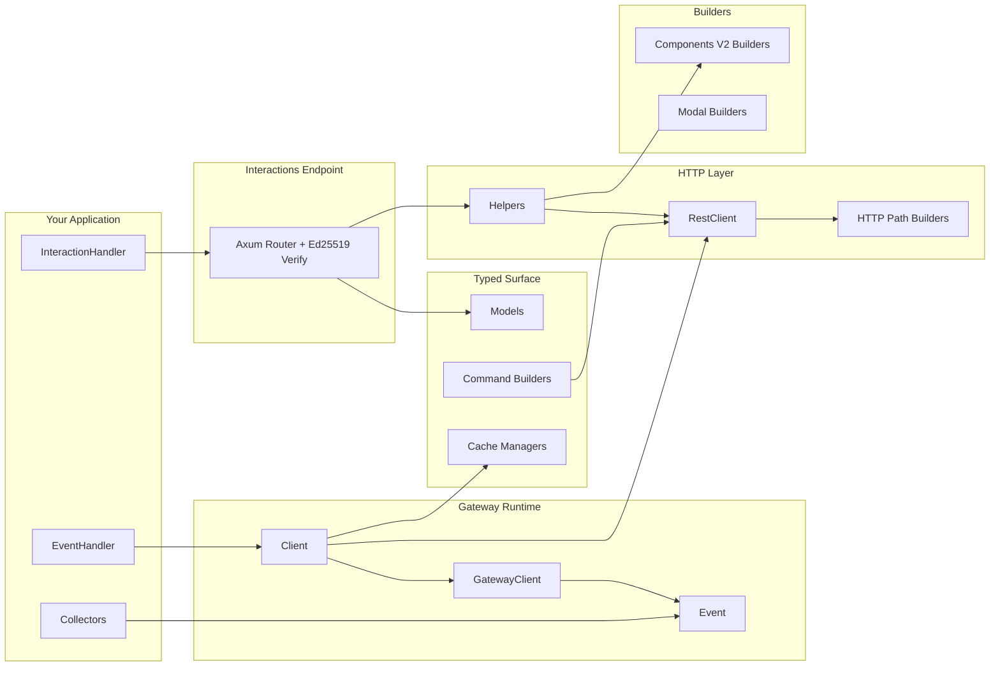

# Architecture

`discord.rs` is split into focused modules so you can compose only what you need.

## Module Layout

- `src/builders/`: fluent payload builders for Components V2 + modals
- `src/model.rs`: thin facade over `src/model/`. It only declares the private domain modules and re-exports their types, so `discordrs::model::X` (and the crate-root re-exports) stay the one public path no matter which file a type lives in
- `src/model/` domain files (one domain per file, each well under 800 lines):
  - `guild.rs` (guild, preview, guild queries and request bodies), `guild_aux.rs` (vanity URL, prune, integrations, widget, welcome screen, templates, onboarding), `member.rs`, `role.rs`
  - `channel.rs` (channels, attachments, overwrites, forum tags, DM channels, followed channels), `thread.rs` (thread members, listings, `ThreadMetadata`)
  - `message.rs` (messages, references, pins, reactions, search, `AllowedMentions`), `component.rs`, `embed.rs`, `poll.rs`
  - `interaction.rs` (interaction variants, `InteractionContextData`, `ResolvedData`, callback responses), `command.rs` (application commands, options, permissions, integration/context types), `application.rs` (applications, activity instances, OAuth2 authorization info), `application_identity.rs`
  - `invite.rs`, `webhook.rs`, `moderation.rs` (bans and auto-moderation), `audit_log.rs`, `scheduled_event.rs`, `media.rs` (stickers, soundboard), `monetization.rs` (SKUs, entitlements, subscriptions), `lobby.rs`
  - `presence.rs` (presences, activities, `UpdatePresence`), `voice.rs` (voice states, regions, voice channel status, stage instances), `gateway.rs` (gateway discovery responses, `RequestGuildMembers`, `RequestChannelInfo`), `user.rs`
  - `entity.rs` (`DiscordModel`), `snowflake.rs`, `permissions.rs` (`PermissionsBitField`)
  - Phase 3 series 1 primitives: `id.rs` with `id/marker.rs` and `id/exceptions.rs` (typed `Id<M>`, its markers, and the wire identifiers that must not become `Id`), `patch.rs` (`Patch` / `Nullable` / `NullablePatch`), and `discriminant.rs` (open discriminants; the one public submodule, because seven names still clash with 2.x types until series 3)
- `src/command.rs`: typed slash/user/message command builders
- `src/gateway/`: websocket runtime, heartbeat/resume, typed event dispatch
- `src/http.rs`: `RestClient`, compatibility `DiscordHttpClient`, and the transport core (construction, the request loop, replay policy, shared helpers). Endpoint methods are not defined here
- `src/http/` endpoint modules: each adds an `impl RestClient` block for one domain and mirrors the matching `src/model/` file — `guild.rs`, `guild_aux.rs`, `member.rs`, `role.rs`, `channel.rs`, `threads.rs`, `messages.rs` (messages, pins), `poll.rs`, `interaction.rs` (callbacks, original responses, follow-ups), `command.rs` (commands and command permissions), `application.rs`, `application_identity.rs`, `invite.rs`, `webhook.rs`, `moderation.rs` (bans), `auto_moderation.rs`, `audit_log.rs`, `scheduled_events.rs`, `emoji.rs`, `media_resources.rs` (stickers, soundboard), `monetization.rs`, `lobby.rs`, `voice.rs` (voice status, stage instances, regions, voice states), `gateway.rs`, `oauth.rs` (current user, OAuth2)
- `src/http/attachment.rs`: `FileAttachment` / `FileUpload` multipart file inputs
- `src/http/body.rs`: JSON/multipart request-body serialization, response-body parsing, and nonce-deduplication detection used by the retry policy
- `src/http/paths.rs`: REST path and query-string helpers, plus `RequestRoute` — the per-request metadata (diagnostic-safe rate-limit key, major-parameter scope, recognized operation) that bucket scoping and the replay policy read instead of re-parsing strings — and the token helpers (`route_token`, `scrub_token`, `redact_path_tokens`)
- `src/http/rate_limit.rs`: REST bucket/global rate-limit state (bucket hash scoped by major parameter), safe wait-duration conversion, and stale bucket cleanup
- `src/http/client_config.rs`: `RestClientBuilder` options, including the opt-in `retry_non_idempotent_requests` policy; managed clients disable redirects so connect failures prove a request was never sent
- `src/http.rs` transport loop: `ReplayPolicy` (always / within the 60s nonce window / never) decides which ambiguous failures may be replayed; `acquire_route_gate` re-checks the bucket key after locking so queued requests follow a newly learned bucket
- `src/cache.rs`: cache handle and manager types; in-memory storage is enabled by default and can be disabled with `default-features = false`
- `src/collector.rs`: opt-in async collectors
- `src/parsers/`: raw + typed interaction parsing helpers
- `src/helpers.rs`: high-level reply helpers for interaction flows
- `src/interactions.rs`: HTTP endpoint mode with signature verification

## Runtime Patterns

- Gateway mode: maintain websocket session, handle typed `Event`, call `RestClient` or managers when needed
- Endpoint mode: receive signed interaction payloads, parse with `parse_interaction(...)`, respond with helpers
- Hybrid mode: use both for richer operational workflows
- Sharding and voice are dedicated feature-gated layers above the base `Client`.
- Add new endpoints to the matching `src/http/<domain>.rs` `impl RestClient` block and new model types to the matching `src/model/<domain>.rs` plus one re-export line in `src/model.rs`; route construction stays in `src/http/paths.rs`, body encoding in `src/http/body.rs`, and rate-limit bookkeeping in `src/http/rate_limit.rs`.
