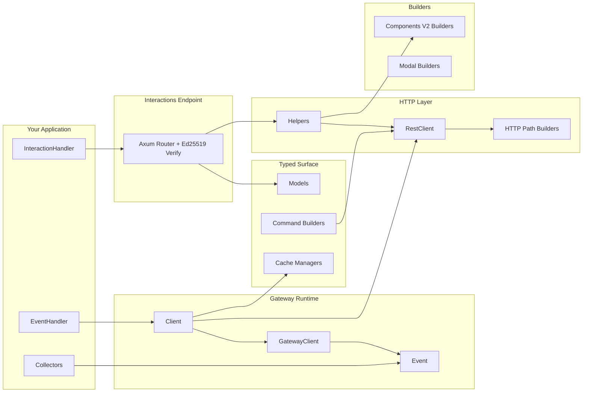

# Architecture

`discord.rs` is split into focused modules so you can compose only what you need.

## Module Layout

- `src/builders/`: fluent payload builders for Components V2 + modals
- `src/model.rs`: typed Discord models, interactions, and ID helpers
- `src/command.rs`: typed slash/user/message command builders
- `src/gateway/`: websocket runtime, heartbeat/resume, typed event dispatch
- `src/http.rs`: `RestClient` and compatibility `DiscordHttpClient`
- `src/http/body.rs`: JSON/multipart request-body serialization, response-body parsing, and nonce-deduplication detection used by the retry policy
- `src/http/paths.rs`: REST path and query-string helpers, plus `RequestRoute` — the per-request metadata (diagnostic-safe rate-limit key, major-parameter scope, recognized operation) that bucket scoping and the replay policy read instead of re-parsing strings — and the token helpers (`route_token`, `scrub_token`, `redact_path_tokens`)
- `src/http/rate_limit.rs`: REST bucket/global rate-limit state (bucket hash scoped by major parameter), safe wait-duration conversion, and stale bucket cleanup
- `src/http/client_config.rs`: `RestClientBuilder` options, including the opt-in `retry_non_idempotent_requests` policy; managed clients disable redirects so connect failures prove a request was never sent
- `src/http.rs` transport loop: `ReplayPolicy` (always / within the 60s nonce window / never) decides which ambiguous failures may be replayed; `acquire_route_gate` re-checks the bucket key after locking so queued requests follow a newly learned bucket
- `src/cache.rs`: cache handle and manager types; in-memory storage is enabled by default and can be disabled with `default-features = false`
- `src/collector.rs`: opt-in async collectors
- `src/parsers/`: raw + typed interaction parsing helpers
- `src/helpers.rs`: high-level reply helpers for interaction flows
- `src/interactions.rs`: HTTP endpoint mode with signature verification

## Runtime Patterns

- Gateway mode: maintain websocket session, handle typed `Event`, call `RestClient` or managers when needed
- Endpoint mode: receive signed interaction payloads, parse with `parse_interaction(...)`, respond with helpers
- Hybrid mode: use both for richer operational workflows
- Sharding and voice are dedicated feature-gated layers above the base `Client`.
- Keep future REST domain splits on the same boundary: endpoint methods stay in `RestClient`, route construction lives in `http_paths`, body encoding lives in `http_body`, and rate-limit bookkeeping lives in `http_rate_limit`.
