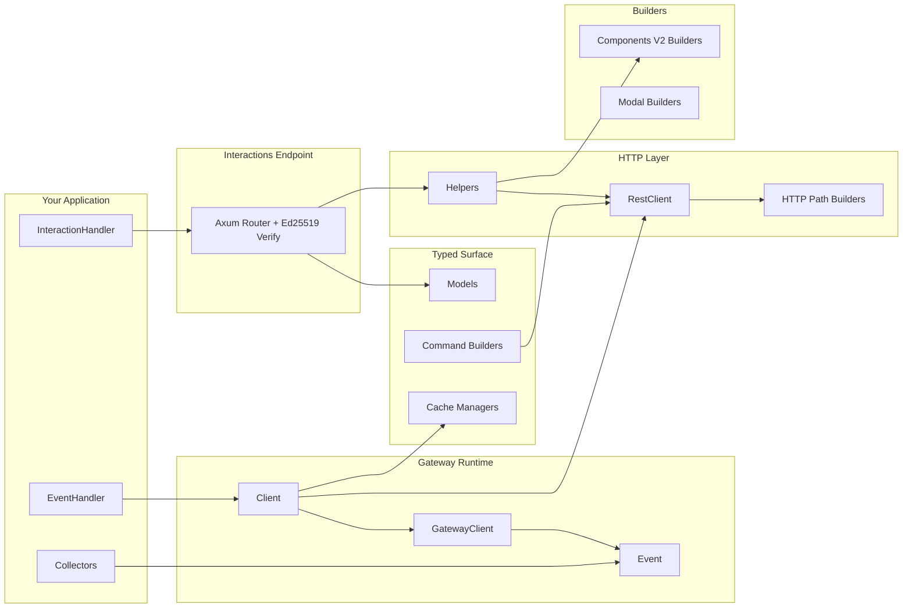

# Architecture

`discord.rs` is split into focused modules so you can compose only what you need.



## Module Layout

- `src/builders/`: fluent payload builders for Components V2 + modals; `limits.rs` holds the component, modal, and embed limits their `validate()` methods check (crate-private, like the public `command::limits` for commands)
- `src/model.rs`: thin facade over `src/model/`. It only declares the private domain modules and re-exports their types, so `discordrs::model::X` (and the crate-root re-exports) stay the one public path no matter which file a type lives in
- `src/model/` domain files (one domain per file, each well under 800 lines):
  - `guild.rs` (guild, preview, guild queries and request bodies), `guild_aux.rs` (vanity URL, prune, integrations, widget, welcome screen, templates, onboarding), `member.rs`, `role.rs`
  - `channel.rs` (channels, attachments, overwrites, forum tags, DM channels, followed channels), `thread.rs` (thread members, listings, `ThreadMetadata`)
  - `message.rs` (messages, references, pins, reactions, search, `AllowedMentions`), `component.rs`, `embed.rs`, `poll.rs`
  - `interaction.rs` (interaction variants, `InteractionContextData`, `ResolvedData`, callback responses), `command.rs` (application commands, options, permissions, integration/context types), `application.rs` (applications, activity instances, OAuth2 authorization info), `application_identity.rs`
  - `invite.rs`, `webhook.rs`, `moderation.rs` (bans and auto-moderation), `audit_log.rs`, `scheduled_event.rs`, `media.rs` (stickers, soundboard), `monetization.rs` (SKUs, entitlements, subscriptions), `lobby.rs`
  - `presence.rs` (presences, activities, `UpdatePresence`, the `PresenceStatus` string vocabulary), `voice.rs` (voice states, regions, voice channel status, stage instances), `gateway.rs` (gateway discovery responses, `RequestGuildMembers`, `RequestChannelInfo`), `user.rs`
  - `entity.rs` (`DiscordModel`), `permissions.rs` (the deprecated `PermissionsBitField` alias of `bitfield::Permissions`, the permission set every model field uses since series 3); the 2.x `snowflake.rs` was removed in series 2 step A (`Snowflake` is now a deprecated alias of `GenericId` declared in `model.rs`). `DiscordModel` has an associated `Marker`, so `id()` returns the model's typed ID
  - Phase 3 primitives: `id.rs` with `id/marker.rs` and `id/exceptions.rs` (typed `Id<M>`, its markers, and the wire identifiers that must not become `Id`; every ID field and parameter has its per-resource alias since step B, and `GenericId` remains only where Discord leaves the kind open). The polymorphic wire IDs live next to their models: `OverwriteTarget` in `channel.rs`, `CommandPermissionTarget`/`CommandPermissionsId` in `command.rs`, `SelectDefaultValue`/`MentionableId` in `component.rs`, `EntitlementOwner` in `monetization.rs`; their round-trip tests are in `polymorphic_tests.rs`, `patch.rs` (`Patch` / `Nullable` / `NullablePatch`), and `discriminant.rs` (open discriminants, the one public submodule and their canonical home; every discriminant field uses them since series 3, and the types are re-exported from `model` and the crate root). Test-only: `fixtures.rs` (`T::fixture()` for models without `Default`), `doc_examples.rs` (round trips of Discord's documented example payloads in `doc_examples/payloads.rs`, regenerated by `ci/doc_examples.py`), and `id::test_id`
- `src/command.rs`: typed slash/user/message command builders
- `src/gateway/`: websocket runtime, heartbeat/resume, typed event dispatch
- `src/http.rs`: `RestClient`, compatibility `DiscordHttpClient`, and the transport core (construction, the request loop, replay policy, shared helpers). Endpoint methods are not defined here
- `src/http/` endpoint modules: each adds an `impl RestClient` block for one domain and mirrors the matching `src/model/` file — `guild.rs`, `guild_aux.rs`, `member.rs`, `role.rs`, `channel.rs`, `threads.rs`, `messages.rs` (messages, pins), `poll.rs`, `interaction.rs` (callbacks, original responses, follow-ups), `command.rs` (commands and command permissions), `application.rs`, `application_identity.rs`, `invite.rs`, `webhook.rs`, `moderation.rs` (bans), `auto_moderation.rs`, `audit_log.rs`, `scheduled_events.rs`, `emoji.rs`, `media_resources.rs` (stickers, soundboard), `monetization.rs`, `lobby.rs`, `voice.rs` (voice status, stage instances, regions, voice states), `gateway.rs`, `oauth.rs` (current user, OAuth2)
- `src/http/attachment.rs`: `FileAttachment` / `FileUpload` multipart file inputs
- `src/http/body.rs`: JSON/multipart request-body serialization, response-body parsing (`decode_json_body`, the one decoder for typed responses), and nonce-deduplication detection used by the retry policy
- `src/http/paths.rs`: REST path and query-string helpers, plus `RequestRoute` — the per-request metadata (diagnostic-safe rate-limit key, major-parameter scope, recognized operation) that bucket scoping and the replay policy read instead of re-parsing strings — and the token helpers (`route_token`, `scrub_token`, `redact_path_tokens`)
- `src/http/rate_limit.rs`: REST bucket/global rate-limit state (bucket hash scoped by major parameter), safe wait-duration conversion, and stale bucket cleanup
- `src/http/client_config.rs`: `RestClientBuilder` options, including the opt-in `retry_non_idempotent_requests` policy; managed clients disable redirects so connect failures prove a request was never sent
- `src/http.rs` transport loop: `RestClient::execute` is the only implementation of the request loop and is not generic; the typed helpers (`request_typed`, `request_no_content`, the multipart and authorization variants) are thin generic shims that encode the body before one await and decode after it (see "Build Time" in `testing-and-coverage.md`). `ReplayPolicy` (always / within the 60s nonce window / never) decides which ambiguous failures may be replayed; `acquire_route_gate` re-checks the bucket key after locking so queued requests follow a newly learned bucket
- `src/task.rs` (`voice`, `sharding`): `spawn_erased`, which spawns long-lived `()` tasks behind `Box<dyn Future>` so they share one copy of tokio's task harness
- `src/cache.rs`: cache handle and manager types; in-memory storage is enabled by default and can be disabled with `default-features = false`
- `src/collector.rs`: opt-in async collectors
- `src/parsers/`: raw + typed interaction parsing helpers
- `src/helpers.rs`: high-level reply helpers for interaction flows
- `src/interactions.rs`: HTTP endpoint mode with signature verification
- `src/hex.rs`: private hex codec for the endpoint's Ed25519 public key and signatures (replaces the `hex` crate)

## Runtime Patterns

- Gateway mode: maintain websocket session, handle typed `Event`, call `RestClient` or managers when needed
- Endpoint mode: receive signed interaction payloads, parse with `parse_interaction(...)`, respond with helpers
- Hybrid mode: use both for richer operational workflows
- Public async traits (`EventHandler`, `CacheBackend`, `InteractionHandler`, `TypedInteractionHandler`, `CachedManager`) declare `fn ... -> impl Future + Send`, so users implement them with plain `async fn` and no proc-macro dependency. Such traits are not object safe, so the gateway runtime shares the handler and the cache backend through private object-safe traits (`ErasedEventHandler` in `src/gateway/bot.rs`, `ErasedCacheBackend` in `src/gateway/bot/backend.rs`) with a blanket impl that boxes each call once. The interactions endpoint is generic over the handler and needs no erasure.
- Sharding and voice are dedicated feature-gated layers above the base `Client`.
- Add new endpoints to the matching `src/http/<domain>.rs` `impl RestClient` block and new model types to the matching `src/model/<domain>.rs` plus one re-export line in `src/model.rs`; route construction stays in `src/http/paths.rs`, body encoding in `src/http/body.rs`, and rate-limit bookkeeping in `src/http/rate_limit.rs`. Endpoints call the existing typed shims (or `execute` for a custom `RequestBody`) instead of adding another generic `async fn` around the transport.

### Shard supervisor events

`ShardingManager::prepare_runtime` gives each shard two things: a status (`ShardRuntimeStatus`, the current state) and a bounded event queue (a history for observers). `ShardRuntimePublisher::publish` applies an event to the status and queues it under one lock. `ShardRuntimeHandle::try_recv_event` / `drain_events` pop from the queue and never touch the status. The queue holds at most 256 events per shard (`SHARD_EVENT_QUEUE_CAPACITY` in `src/sharding.rs`). When it is full, the oldest event is dropped, and the next pop yields `ShardSupervisorEvent::Lagged { shard_id, missed }` before the oldest kept event. Only `attach_runtime` still reads a caller's std channel; its events bypass `publish`, so they are applied when received.

```text
[Decision Log]
- Purpose: keep supervisor memory bounded under reconnect/error churn even if the
  application never calls drain_events, and keep statuses() current whether or not
  anyone drains.
- Existing implementation and constraints: every published event went into an unbounded
  std::sync::mpsc channel that only drain_events/poll_event emptied, and ShardSupervisor
  users who only read statuses() never drained it. Receiving applied events a second
  time, after publish already had, so polling one old event rolled the status back
  (Running over a newer Reconnecting). Public `event_tx: Sender` fields let callers
  bypass publish. attach_runtime takes a caller-owned Receiver. Publishers run on async
  tasks, so publishing must never block.
- Alternatives considered: (1) std sync_channel(n) + try_send: drops the newest events,
  needs a side counter to report the gap, and still changes the event_tx type.
  (2) tokio::sync::broadcast: drop-oldest with Lagged built in, but it allocates every
  slot up front (256 slots x every shard, used or not), and each receiver clone gets its
  own cursor while the handles share one drain. (3) Keep the unbounded channel and
  document that it must be drained: memory still grows by default. (4) A drop counter
  method instead of an in-band marker: easy to miss, and it loses where the gap is.
- Chosen approach: a VecDeque capped at 256 per shard behind the existing std mutex.
  Overflow drops the oldest event, and the next pop yields Lagged { shard_id, missed }.
  The status is written only by publish. The event_tx fields are removed, so events
  go through publish. attach_runtime channels keep apply-on-receive.
- Why this over the alternatives: drop-oldest keeps the newest, most useful events. The
  in-band marker sits exactly where events are missing, and a lagging observer resyncs
  from statuses(), which is authoritative. No new dependency, no blocking, no eager
  allocation, and the lock discipline is unchanged (queue before status).
- Pros, cons, and impact: per-shard memory is bounded without a consumer, and draining
  never changes statuses. Breaking for 3.0: ShardRuntimeChannels::event_tx and
  ShardRuntimePublisher::event_tx are removed (use publish), and the new Lagged variant
  breaks exhaustive matches. Observers that fall more than 256 events behind on a shard
  see Lagged. A channel passed to attach_runtime stays bounded only by its owner.
```

## Code rules

Library code follows these rules, and the `[lints]` table in `Cargo.toml` makes clippy reject a violation on every target (CI runs `cargo clippy --all-targets -- -D warnings` for all and default features on the pinned toolchain, and `cargo doc` with `RUSTDOCFLAGS="-D warnings"`).

| Rule | Enforced by |
| --- | --- |
| No `unsafe` | `#![forbid(unsafe_code)]` in `src/lib.rs`; `unsafe_code = "deny"` for other targets |
| No `unwrap()` / `expect()`; return the error or handle it | `clippy::unwrap_used`, `clippy::expect_used` |
| No `panic!`, `todo!`, `unimplemented!`, `dbg!` | `clippy::panic`, `clippy::todo`, `clippy::unimplemented`, `clippy::dbg_macro` |
| No `as` conversions: `From` / `TryFrom` (saturating where the value cannot exceed the target), or a named helper where wrapping is the point | `clippy::as_conversions` |
| No silent `let _ = ...` of a `#[must_use]` value or a future: handle or log the error, or discard explicitly with `.ok()` and a comment saying why the failure is expected | `clippy::let_underscore_must_use`, `clippy::let_underscore_future` |
| Every lint suppression states why: `#[expect(lint, reason = "...")]` at the site where it fires, `allow` only when the lint does not fire on every supported toolchain | `clippy::allow_attributes_without_reason` |
| No std lock or `RefCell` guard across an `.await`; each shared mutable field carries a one-line comment saying who shares it | `clippy::await_holding_lock`, `clippy::await_holding_refcell_ref` |
| `Arc::clone(&x)` for reference-counted pointers, so a pointer copy reads differently from a deep clone | `clippy::clone_on_ref_ptr` |
| No `mem::forget` | `clippy::mem_forget` |
| Discord limits, opcodes, close codes, and protocol sizes are named constants with a doc comment citing the source (`command::limits`, `builders/limits.rs`, the `OP_*` / `CLOSE_*` / `VOICE_OP_*` / RTP and DAVE constants) | review |
| Intra-doc links resolve | `cargo doc` with `-D warnings` in CI |

Unit tests (through `cfg_attr(test, allow(...))` in `src/lib.rs`), integration tests, and examples may unwrap, panic, cast, and discard, each opt-out with a reason: a failure there fails the test or stops the demo, not a user's bot. Library code has no such blanket opt-out. The two remaining `panic!` sites are the deprecated `interactions_endpoint` / `typed_interactions_endpoint`, each under `#[expect(clippy::panic, reason = ...)]` until they are removed.

```text
[Decision Log]
- 목적과 의도: unwrap·panic·as·let _ 같은 습관이 라이브러리 코드에 다시 들어오지 않게
  리뷰가 아니라 빌드가 막게 한다.
- 기존 구현 및 제약 조건: 2026-10-11 감사 시점에 라이브러리에는 unsafe/unwrap/expect가
  없었지만 as 34곳, must-use 값을 버리는 let _ 22곳(전체 26곳), 이유 없는 allow 9곳,
  panic 2곳이 남아 있었다. 테스트는 unwrap을 1,700곳 넘게 쓴다. MSRV 1.88, CI 고정 1.99.
- 검토한 주요 대안: (1) lib.rs의 #![deny(...)], (2) CI 명령줄의 -D clippy::..., (3) Cargo.toml [lints].
- 선택한 방식: (3) + lib.rs의 #![forbid(unsafe_code)] + 테스트·예제의 이유 있는 범위 지정 allow.
- 다른 대안 대신 이 방식을 선택한 이유: (1)은 통합 테스트·예제에 닿지 않고, (2)는 로컬
  cargo clippy와 CI가 달라진다. [lints]는 Rust 1.74부터 안정이라 MSRV에서도 읽히고,
  모든 타깃과 모든 실행 경로가 같은 규칙을 본다.
- 장점, 단점 및 영향: 위반은 PR 전에 로컬에서 바로 실패한다. 대신 테스트·예제마다 허용
  목록과 이유를 유지해야 하고, 라이브러리의 예외는 사이트별 #[expect]로만 둘 수 있다.
  공개 API 서명(create_container, authorization_url, broadcast)의 값 전달은 호환성 때문에 남겼다.
```
