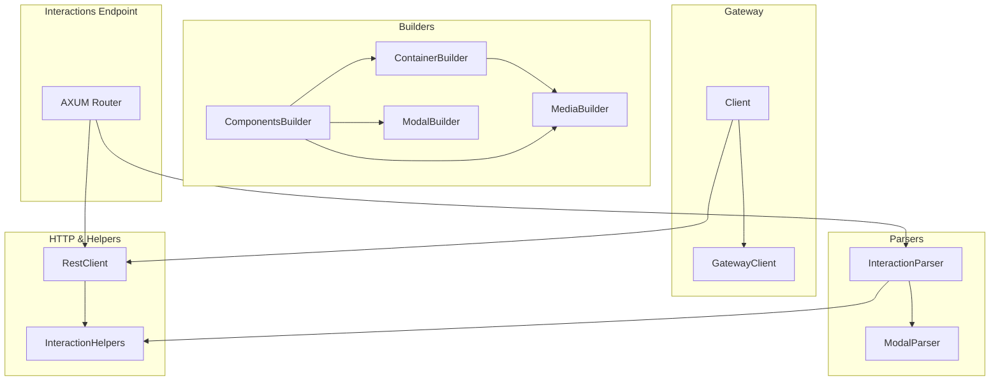

# discord.rs Library Documentation

> This manual still contains low-level historical detail, but the current docs site now prefers `Client`, `RestClient`, typed models/events, command builders, cache managers, and collectors. Start with [Getting Started](getting-started.md), [Architecture](architecture.md), and the new API pages before using the older sections below.

## Overview

discord.rs is a standalone Rust framework for building Discord bots. It provides:

- **Gateway WebSocket runtime** for connecting, heartbeating, identifying, resuming, and dispatching events.
- **HTTP REST client** with automatic rate-limit retry for sending messages, managing commands, and responding to interactions.
- **Builders** for Components V2 payloads (buttons, selects, media galleries, modals), enabling fluent construction of rich messages.
- **Parsers** for routing and extracting data from raw interaction payloads and V2 modal submissions.
- **Helpers** and **Interaction Endpoint** support for easily replying to slash commands, component interactions, and modal submissions.
- **Voice helpers** for voice gateway/UDP setup, Opus-frame RTP send, RTP-size transport decrypt, Opus PCM decode, and DAVE end-to-end encryption run by the voice runtime.
- **OAuth2 backend helpers** for authorization URLs, authorization-code exchange, and refresh-token exchange.
- **Typed Discord coverage** for all official REST route shapes audited on 2026-05-02, plus Webhook Resource routes, Webhook Events, lobbies, Gateway rate-limit, reaction metadata, presence metadata events, polls, subscriptions, entitlements, soundboard, threads, forum fields, invites including target-user CSV flows, integrations, OAuth2 metadata, current and legacy pin routes, and Social SDK lobby helpers.

This modular design separates concerns into `builders/`, `gateway/`, `parsers/`, and `http/` directories, with core types and utilities at the root.

## Architecture Overview



## 1. Builders Module

The **builders** crate offers a fluent, type-safe API for constructing Discord Components V2 messages and modals.

### 1.1 Components (`src/builders/components.rs`)

- **Purpose:** Build individual interactive components and assemble component messages.
- **Key Types:**
  - `CustomButtonBuilder`, `LinkButtonBuilder`, `PremiumButtonBuilder`: the three button kinds, each with only the fields Discord allows it (the 2.x `ButtonBuilder` is deprecated and converts only with `Button::try_from`).
  - `SelectMenuBuilder::{string, user, role, mentionable, channel}`: return a builder per select kind with only that kind's setters (options, typed defaults, channel types); a select menu is its own action row.
  - `ActionRowBuilder`: a row of up to five buttons.
  - `ComponentsV2Message`: the top-level components of a Components V2 message.
  - Every `build()` returns the typed model from `discordrs::request` (no `serde_json::Value`); see the Builders API page.
- **Usage Example:**
  ```rust
  let button = CustomButtonBuilder::new("btn_1")
      .label("Click me")
      .style(ButtonStyle::PRIMARY);
  let row = ActionRowBuilder::new().add_button(button);
  let message = ComponentsV2Message::new()
      .add_action_row(row)
      .add_action_row(SelectMenuBuilder::user("pick_user"));
  ```

### 1.2 Container (`src/builders/container.rs`)

- **Purpose:** Compose a reusable container message with text, separators, buttons, sections, media.
- **Key Types:**
  - `ContainerBuilder`: holds a sequence of components, accent color, optional spoiler.
  - `TextDisplayBuilder`: render markdown or plain text blocks.
  - `SeparatorBuilder`: insert spacing or divider between components.
- **Helpers:**
  - `create_container(title, description, buttons, image_url)`: quick factory for common layouts.
  - `create_default_buttons("general" | "status")`: returns predefined button sets.

### 1.3 Media (`src/builders/media.rs`)

- **Purpose:** Build media-rich sections and galleries.
- **Key Types:**
  - `MediaGalleryBuilder`: assemble multiple images into a scrollable gallery.
  - `SectionBuilder`: combine text with a thumbnail or button accessory; the accessory is required and tracked in the builder's type.
  - `FileBuilder` & `ThumbnailBuilder`: attach files or thumbnails to messages.

### 1.4 Modal (`src/builders/modal.rs`)

- **Purpose:** Construct interactive modals with text inputs, selects, radio and checkbox groups.
- **Key Types:**
  - `ModalBuilder`: root builder for a modal dialog (custom ID, title, components).
  - `TextInputBuilder`: single-line or paragraph text inputs with labels, placeholders, length limits.
  - `RadioGroupBuilder` & `CheckboxGroupBuilder`: choice selection groups.
  - `FileUploadBuilder`, `LabelBuilder`: embed file inputs or descriptive labels.
- **Pattern:** Modal inputs sit in labels (`LabelBuilder`); message action rows are not modal components.

### 1.5 Module Exports (`src/builders/mod.rs`)

Re-exports the supported builder surface for ergonomic import. Use `discordrs::builders::{...}` or the crate-root re-exports; the implementation submodules (`components`, `container`, `media`, `modal`) are internal and not part of the public path contract.

```rust
pub use components::ButtonBuilder; // deprecated
pub use components::{
    ActionRowBuilder, ChannelSelectBuilder, ComponentsV2Message, CustomButtonBuilder,
    LinkButtonBuilder, MentionableSelectBuilder, PremiumButtonBuilder, RoleSelectBuilder,
    SelectMenuBuilder, StringSelectBuilder, UserSelectBuilder,
};
pub use embed::EmbedBuilder;
pub use message::MessageBuilder;
pub use container::{create_container, ContainerBuilder, SeparatorBuilder, TextDisplayBuilder};
pub use media::{FileBuilder, MediaGalleryBuilder, SectionBuilder, ThumbnailBuilder};
pub use modal::{CheckboxBuilder, CheckboxGroupBuilder, FileUploadBuilder, LabelBuilder, ModalBuilder, RadioGroupBuilder, TextInputBuilder};
```

---

## 2. Gateway Module

Enables a full bot runtime using Discord’s Gateway API.

### 2.1 GatewayClient (`src/gateway/client.rs`)

- **Purpose:** Manage a long-lived WebSocket connection to Discord. Crate-internal; `Client` creates and drives it.
- **Features:**
  - Identify, resume, reconnect logic with exponential backoff.
  - Heartbeat scheduling and “zombie” detection.
  - Dispatches all events via a callback supplied by `Client`.
- **Key Methods:**
  - `new(token, intents)`: initialize client.
  - `run(on_event)`: start connect→listen loop.
  - Internal `connect_and_run`: handshake, heartbeat, event loop.

### 2.2 Client & ClientBuilder (`src/gateway/bot.rs`)

- **Purpose:** High-level wrapper for GatewayClient + HTTP context + event handling.
- **Key Types:**
  - `ClientBuilder` (from `Client::builder(token, intents)`): configure event handler, application ID, type map entries. `BotClient` and `BotClientBuilder` are compatibility aliases.
  - `Context`: shared across handlers, provides `http: Arc<RestClient>` and `data: Arc<RwLock<TypeMap>>`.
  - `EventHandler` trait: `handle_event(ctx, Arc<Event>)` receives every event as the shared `Arc<Event>` (match `event.kind()` for an `EventKind`) and by default forwards it to typed hooks such as `ready(ctx, &ReadyPayload)`, `message_create(ctx, Arc<Message>)`, and `interaction_create(ctx, &Interaction)`; unknown dispatches go to `raw_event` and undecodable payloads to `decode_failed`. Every typed hook defaults to a no-op.
- **Flow:**
  1. Build with `Client::builder(token, intents)`, `.event_handler(handler)`, and optional `.application_id(id)`.
  2. `.start().await` spins up GatewayClient and dispatches events into async handler methods.

### 2.3 Module Export (`src/gateway/mod.rs`)

```rust
#[cfg(feature = "cache")]
pub use bot::CacheBackendHealth;
pub use bot::{
    BotClient, BotClientBuilder, Client, ClientBuilder, Context, EventDispatchMode, EventHandler,
    InteractionOverloadReason, OverloadedInteraction, TypeMap,
};
pub use messenger::ShardMessenger;
#[cfg(feature = "sharding")]
pub use supervisor::ShardSupervisor;
```

---

## 3. Parsers Module

Convert raw JSON payloads into typed enums and structs.

### 3.1 Interaction Parser (`src/parsers/interaction.rs`)

- **Key Types:**
  - `RawInteraction`: enum of `Ping`, `Command`, `Autocomplete`, `Component`, `ModalSubmit`.
  - `InteractionContext`: common fields (id, token, application_id, guild_id, channel_id, user_id).
- **Functions:**
  - `parse_raw_interaction(&Value) -> Result<RawInteraction, DiscordError>`
  - `parse_interaction_context(&Value) -> Result<InteractionContext, DiscordError>`
  - `decode_interaction(&str) -> Result<Interaction, DiscordError>`: the typed model (`parse_interaction(&Value)` for an already-parsed value).

### 3.2 Modal Parser (`src/parsers/modal.rs`)

- **Key Types:**
  - `V2ModalComponent`: leaf enum variants (text input, select, radio, checkbox, etc.).
  - `V2ModalSubmission`: custom ID + flat list of `V2ModalComponent`.
- **Function:**
  - `parse_modal_submission(&Value) -> Result<V2ModalSubmission, DiscordError>`

### 3.3 Module & Utilities (`src/parsers/mod.rs`)

Re-exports the public parser surface, also available at the crate root:

- `decode_interaction`, `parse_interaction`, `parse_interaction_context`, `parse_raw_interaction`, `parse_modal_submission`
- `InteractionContext`, `RawInteraction`, `V2ModalComponent`, `V2ModalSubmission`

The JSON field helpers shared by both parsers are crate-internal.

---

## 4. HTTP & Helpers

### 4.1 RestClient (`src/http.rs`, endpoints in `src/http/`)

- **Purpose:** REST client targeting Discord API v10. `DiscordHttpClient` is a compatibility alias.
- **Features:**
  - Automatic retry on `429 Too Many Requests`.
  - Common endpoints: create/update/delete messages, manage application commands, interaction responses, and followups.
- **Key Methods:**
  - `new(token, application_id)`
  - `create_message(channel_id, &CreateMessage)`, `edit_message(channel_id, message_id, &EditMessage)`
  - `create_interaction_response(interaction_id, interaction_token, &InteractionResponse)`
  - `create_followup_message(interaction_token, &CreateFollowup)`
  - `request::<T>(RawRequest)`: any method and path for routes without a typed method, with the same rate limit logic.

### 4.2 Interaction Helpers (`src/helpers.rs`)

- **Purpose:** Simplify sending and replying to interaction-based messages.
- **Functions:**
  - `send_container_message`, `respond_with_container`, `respond_component_with_container`, `respond_modal_with_container`
  - Wrap builders into HTTP calls, manage ephemeral flags.

---

## 5. Interactions Endpoint (`src/interactions.rs`)

- **Purpose:** Provide an HTTP `/interactions` endpoint for Discord’s interaction callbacks.
- **Components:**
  - Signature verification using Ed25519.
  - Request routing with Axum; `try_interactions_endpoint(public_key, handler)` builds the `Router`.
  - Calls a user’s `InteractionHandler` (or `TypedInteractionHandler`), which returns an `EndpointReply`: `Inline` (a boxed `InteractionResponse`, answered with 200) or `Accepted` (202 with no body, when the initial response goes over REST).
  - Automatic JSON encoding of `InteractionResponse` variants: `Pong`, `ChannelMessage`, `DeferredChannelMessage`, `DeferredUpdateMessage`, `UpdateMessage`, `AutocompleteResult`, `Modal`, `LaunchActivity`, `Raw`, and the deprecated `PremiumRequired`.

---

## 6. Core Types & Constants

- **Constants** (`src/constants.rs`): gateway intents and the components-v2 message flag. Component types, button styles, text-input styles, and separator spacings are the open discriminants `ComponentType`, `ButtonStyle`, `TextInputStyle`, and `SeparatorSpacing` since 3.0.
- **Errors** (`src/error.rs`): `DiscordError`, the crate's error type (the 2.x `Error` alias was removed in 3.0).
- **Types** (`src/types.rs`): 
  - `ButtonConfig`, `Emoji`, `SelectOption`, `MediaGalleryItem`, `MediaInfo`.
  - `TypeMap` (defined in `src/gateway/bot.rs`) for storing user data in `Context`.

---

## 7. Project Files

- **README.md**: High-level overview, features, installation, quickstart examples.
- **USAGE.md**: Expanded usage guide covering bot startup, message sending, and interaction flows.
- **CHANGELOG.md**: Version history with breaking changes and new features.
- **Cargo.toml**: Crate metadata, feature flags (`gateway`, `zstd-stream`, `interactions`, `cache`, `collectors`, `sharding`, `voice`, `voice-encode`, and `dave`, an alias of `voice`), and dependencies.
- **LICENSE-APACHE** & **LICENSE-MIT**: Dual licensing terms.

---

This documentation outlines each module’s purpose, core types, methods, and how they interconnect to form a cohesive Discord bot framework in Rust.
