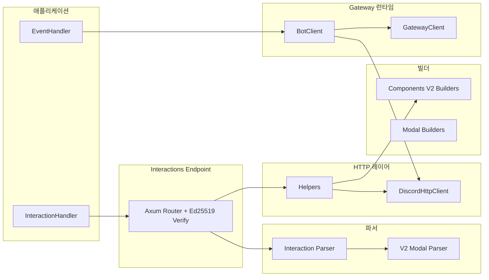

# 아키텍처

`discordrs`는 역할별 모듈 분리 구조를 가집니다.

## 모듈 구성

- `src/builders/`: Components V2, Modal 페이로드 빌더
- `src/gateway/`: WebSocket 런타임, heartbeat/resume/reconnect
- `src/http.rs`: REST 클라이언트 및 429 재시도
- `src/parsers/`: 인터랙션/모달 파싱
- `src/helpers.rs`: 응답 헬퍼
- `src/interactions.rs`: HTTP 엔드포인트 모드
- `src/hex.rs`: 엔드포인트의 Ed25519 공개 키·서명용 비공개 16진수 코덱(`hex` 크레이트 대체)
- 공개 async 트레잇(`EventHandler`, `CacheBackend`, 인터랙션 핸들러, `CachedManager`)은 `fn ... -> impl Future + Send`로 선언해 사용자가 매크로 없이 `async fn`으로 구현합니다. 이런 트레잇은 object safe가 아니므로 게이트웨이 런타임은 비공개 트레잇(`ErasedEventHandler`, `ErasedCacheBackend`)과 블랭킷 impl로 핸들러·캐시 백엔드를 공유하며, 호출마다 한 번 박싱합니다.
