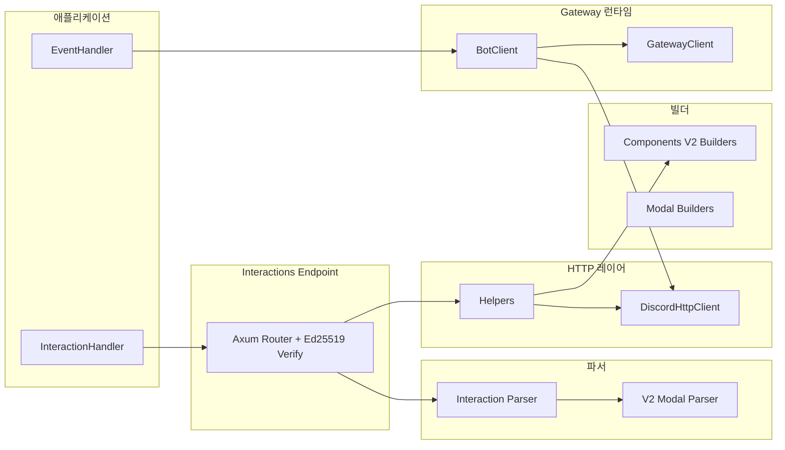

# 아키텍처

`discordrs`는 역할별 모듈 분리 구조를 가집니다.

## 모듈 구성

- `src/builders/`: Components V2, Modal 페이로드 빌더. `limits.rs`에 `validate()`가 검사하는 컴포넌트·모달·임베드 한도를 모았습니다(비공개, 커맨드용 공개 `command::limits`와 같은 방식)
- `src/gateway/`: WebSocket 런타임, heartbeat/resume/reconnect
- `src/http.rs`: REST 클라이언트 및 429 재시도
- `src/parsers/`: 인터랙션/모달 파싱
- `src/helpers.rs`: 응답 헬퍼
- `src/interactions.rs`: HTTP 엔드포인트 모드
- `src/hex.rs`: 엔드포인트의 Ed25519 공개 키·서명용 비공개 16진수 코덱(`hex` 크레이트 대체)
- 공개 async 트레잇(`EventHandler`, `CacheBackend`, 인터랙션 핸들러, `CachedManager`)은 `fn ... -> impl Future + Send`로 선언해 사용자가 매크로 없이 `async fn`으로 구현합니다. 이런 트레잇은 object safe가 아니므로 게이트웨이 런타임은 비공개 트레잇(`ErasedEventHandler`, `ErasedCacheBackend`)과 블랭킷 impl로 핸들러·캐시 백엔드를 공유하며, 호출마다 한 번 박싱합니다.

## 코드 규칙

라이브러리 코드는 아래 규칙을 따르며, `Cargo.toml`의 `[lints]` 표가 모든 타깃에서 위반을 clippy 오류로 만듭니다. CI는 고정 툴체인에서 전체·기본 기능으로 `cargo clippy --all-targets -- -D warnings`와 `RUSTDOCFLAGS="-D warnings" cargo doc`을 실행합니다.

- `unsafe` 금지: `src/lib.rs`의 `#![forbid(unsafe_code)]`, 다른 타깃은 `unsafe_code = "deny"`
- `unwrap()`/`expect()`, `panic!`/`todo!`/`unimplemented!`/`dbg!`, `mem::forget` 금지
- `as` 변환 금지: `From`/`TryFrom`(값이 넘칠 수 없으면 포화 변환), 일부러 자르는 경우는 이름 있는 헬퍼
- `#[must_use]` 값이나 future를 `let _ =`로 버리지 않기: 처리·로그, 또는 실패가 정상인 이유를 주석으로 적고 `.ok()`
- 모든 lint 억제에 이유: 실제로 발생하는 곳에 `#[expect(lint, reason = "...")]`, 지원 툴체인 전부에서 발생하지 않을 때만 `allow`
- std 락·`RefCell` 가드를 `.await` 너머로 들고 있지 않기, 공유 가변 필드마다 누가 공유하는지 한 줄 주석
- 참조 카운트 포인터는 `Arc::clone(&x)`
- Discord 한도·opcode·close code·프로토콜 크기는 출처를 적은 이름 있는 상수
- intra-doc 링크는 모두 해석되어야 함

단위 테스트(`src/lib.rs`의 `cfg_attr(test, allow(...))`), 통합 테스트, 예제는 이유를 적고 unwrap·panic·변환·버리기를 허용합니다. 남은 `panic!`은 deprecated된 `interactions_endpoint`/`typed_interactions_endpoint` 두 곳뿐이며, 제거될 때까지 `#[expect(clippy::panic, reason = ...)]` 아래에 있습니다. 결정 기록은 영어 문서의 "Code rules" 절에 있습니다.
