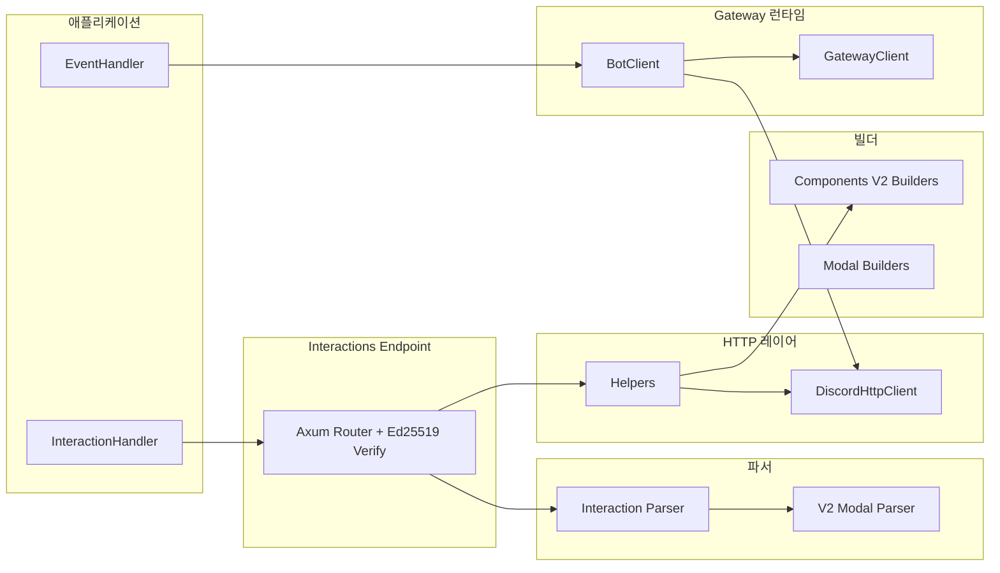

# 아키텍처

`discordrs`는 역할별 모듈 분리 구조를 가집니다.



## 모듈 구성

- `src/builders/`: Components V2, Modal 페이로드 빌더. `limits.rs`에 `validate()`가 검사하는 컴포넌트·모달·임베드 한도를 모았습니다(비공개, 커맨드용 공개 `command::limits`와 같은 방식)
- `src/event.rs`: `Event` 봉투(`EventKind`, `EventMetadata`, 선택적 원본 payload)와 이벤트별 payload 타입. `src/event/decode.rs`는 디스패치의 `d` 텍스트를 바로 타입으로 디코딩하며, 이름 인턴 표와 디코더 분기를 정렬된 표 하나에서 만듭니다
- `src/gateway/`: WebSocket 런타임, heartbeat/resume/reconnect. 읽기 루프(`client.rs`)는 얕은 봉투만 읽고 `d`를 `Box<RawValue>`로 큐에 넣으며, 샤드별 처리기(`bot/pipeline.rs`)가 디코딩하고 캐시·외부 백엔드(`bot/backend.rs`)를 갱신한 뒤 `Arc<Event>` 하나를 컬렉터 저널과 핸들러 호출이 공유합니다
- `src/model/gateway_payload.rs`: 게이트웨이 전용 payload. 캐시 저장 단위로 나눈 `GuildCreate`(사용 불가 길드와 구분하는 `GuildCreatePayload`)와 `Patch` 필드를 쓰는 부분 갱신 `MessageUpdate` / `PartialUser`
- `src/http.rs`: REST 클라이언트 전송 루프(`RestClient::execute`, 429·재시도·토큰 가리기). 엔드포인트는 `src/http/<도메인>.rs`에 있고, 각 엔드포인트는 라우트 목록(`src/http/routes.rs`)의 `RouteId`를 넘겨 메서드와 인증을 목록에서 가져옵니다. 본문은 `serde_json::to_vec`으로 한 번 인코딩해 재시도에 그대로 씁니다. `RestClient::request(RawRequest)`(`src/http/raw.rs`)는 같은 루프를 지나는 원시 요청 탈출구입니다
- `src/parsers/`: 인터랙션 디코딩. `interaction/wire.rs`가 `Interaction`의 와이어 형식 `Deserialize`/`Serialize`(JSON 텍스트에서 한 번에, `Value` 없이; 게이트웨이와 타입 엔드포인트의 진입점은 `decode_interaction`), `modal.rs`가 제출된 모달 값의 같은 구현, `mod.rs`의 `Value` 헬퍼는 원시 핸들러 API(`RawInteraction`, `InteractionContext`)용
- `src/helpers.rs`: 응답 헬퍼
- `src/interactions.rs`: HTTP 엔드포인트 모드
- `src/hex.rs`: 엔드포인트의 Ed25519 공개 키·서명용 비공개 16진수 코덱(`hex` 크레이트 대체)
- 공개 async 트레잇(`EventHandler`, `CacheBackend`, 인터랙션 핸들러, `CachedManager`)은 `fn ... -> impl Future + Send`로 선언해 사용자가 매크로 없이 `async fn`으로 구현합니다. 이런 트레잇은 object safe가 아니므로 게이트웨이 런타임은 비공개 트레잇(`ErasedEventHandler`, `ErasedCacheBackend`)과 블랭킷 impl로 핸들러·캐시 백엔드를 공유하며, 호출마다 한 번 박싱합니다.

## 샤드 감독 이벤트

`ShardingManager::prepare_runtime`은 샤드마다 두 가지를 둡니다. 하나는 현재 상태인 상태값(`ShardRuntimeStatus`)이고, 다른 하나는 관찰자용 이력인 크기 제한 이벤트 큐입니다. `ShardRuntimePublisher::publish`는 한 잠금 안에서 이벤트를 상태값에 반영하고 큐에 넣습니다. `ShardRuntimeHandle::try_recv_event`와 `drain_events`는 큐에서 꺼내기만 하고 상태값은 건드리지 않습니다. 큐는 샤드당 최대 256개(`src/sharding.rs`의 `SHARD_EVENT_QUEUE_CAPACITY`)입니다. 가득 차면 가장 오래된 이벤트를 버리고, 다음 꺼내기는 남은 가장 오래된 이벤트보다 먼저 `ShardSupervisorEvent::Lagged { shard_id, missed }`를 돌려줍니다. `attach_runtime`만 호출자의 std 채널을 그대로 읽습니다. 그 이벤트는 `publish`를 거치지 않으므로 받을 때 반영합니다.

```text
[Decision Log]
- 목적과 의도: 애플리케이션이 drain_events를 한 번도 부르지 않아도 재연결·오류가 반복될 때
  감독자 메모리가 한정되게 하고, 비우든 말든 statuses()가 항상 최신이 되게 한다.
- 기존 구현 및 제약 조건: 발행된 이벤트는 모두 제한 없는 std::sync::mpsc 채널에 쌓였고,
  비우는 곳은 drain_events/poll_event뿐이었다. statuses()만 읽는 ShardSupervisor 사용자는
  채널을 비우지 않는다. 받을 때 publish가 이미 반영한 이벤트를 한 번 더 반영해서, 오래된
  이벤트 하나만 꺼내도 상태가 되돌아갔다(더 새로운 Reconnecting 위에 Running).
  공개 `event_tx: Sender` 필드로 publish를 우회할 수 있었다. attach_runtime은 호출자가
  가진 Receiver를 받는다. 발행자는 async 태스크에서 돌기 때문에 발행이 막히면 안 된다.
- 검토한 주요 대안: (1) std sync_channel(n) + try_send: 새 이벤트를 버리고, 빈틈을 알리려면
  별도 카운터가 필요하며, event_tx 타입도 바뀐다. (2) tokio::sync::broadcast: 오래된 것부터
  버리고 Lagged도 있지만 슬롯을 미리 전부 할당하고(쓰든 안 쓰든 샤드마다 256칸),
  핸들은 한 큐를 함께 비우는데 수신자 복제마다 커서가 따로 생긴다. (3) 제한 없는 채널을 두고
  꼭 비우라고 문서화: 기본 동작에서 메모리가 계속 는다. (4) 큐 안의 표시 대신 버림 카운터
  메서드: 놓치기 쉽고 빈틈의 위치를 잃는다.
- 선택한 방식: 기존 std 뮤텍스 뒤에 샤드당 256개로 제한한 VecDeque를 둔다. 넘치면 가장
  오래된 이벤트를 버리고, 다음 꺼내기가 Lagged { shard_id, missed }를 돌려준다. 상태값은
  publish만 쓴다. event_tx 필드를 없애 이벤트는 publish로만 보낸다. attach_runtime 채널은
  받을 때 반영하는 방식을 유지한다.
- 다른 대안 대신 이 방식을 선택한 이유: 오래된 것부터 버리면 더 새롭고 쓸모 있는 이벤트가
  남는다. 큐 안의 표시가 빈틈 자리에 정확히 놓이고, 뒤처진 관찰자는 권위 있는 statuses()로
  다시 맞춘다. 새 의존성·블로킹·선할당이 없고 잠금 순서(큐 다음 상태값)도 그대로다.
- 장점, 단점 및 영향: 소비자가 없어도 샤드당 메모리가 한정되고, 비워도 상태가 바뀌지 않는다.
  3.0 호환성 깨짐: ShardRuntimeChannels::event_tx와 ShardRuntimePublisher::event_tx가
  없어졌고(publish 사용), 새 Lagged 변형 때문에 모든 경우를 나열한 match는 고쳐야 한다.
  샤드에서 256개 넘게 뒤처진 관찰자는 Lagged를 본다. attach_runtime에 넘긴 채널의 크기는
  여전히 그 소유자가 정한다.
```

## 코드 규칙

라이브러리 코드는 아래 규칙을 따르며, `Cargo.toml`의 `[lints]` 표가 모든 타깃에서 위반을 clippy 오류로 만듭니다. CI는 고정 툴체인에서 전체·기본 기능으로 `cargo clippy --all-targets -- -D warnings`와 `RUSTDOCFLAGS="-D warnings" cargo doc`을 실행합니다.

- `unsafe` 금지: `src/lib.rs`의 `#![forbid(unsafe_code)]`, 다른 타깃은 `unsafe_code = "deny"`
- `unwrap()`/`expect()`, `panic!`/`todo!`/`unimplemented!`/`dbg!`, `mem::forget` 금지
- `as` 변환 금지: `From`/`TryFrom`(값이 넘칠 수 없으면 포화 변환), 일부러 자르는 경우는 이름 있는 헬퍼
- `#[must_use]` 값이나 future를 `let _ =`로 버리지 않기: 처리·로그, 또는 실패가 정상인 이유를 주석으로 적고 `.ok()`
- 모든 lint 억제에 이유: 실제로 발생하는 곳에 `#[expect(lint, reason = "...")]`, 지원 툴체인 전부에서 발생하지 않을 때만 `allow`
- std 락·`RefCell` 가드를 `.await` 너머로 들고 있지 않기, 공유 가변 필드마다 누가 공유하는지 한 줄 주석
- 참조 카운트 포인터는 `Arc::clone(&x)`
- Discord 한도·opcode·close code·프로토콜 크기는 출처를 적은 이름 있는 상수
- intra-doc 링크는 모두 해석되어야 함

단위 테스트(`src/lib.rs`의 `cfg_attr(test, allow(...))`), 통합 테스트, 예제는 이유를 적고 unwrap·panic·변환·버리기를 허용합니다. 남은 `panic!`은 deprecated된 `interactions_endpoint`/`typed_interactions_endpoint` 두 곳뿐이며, 제거될 때까지 `#[expect(clippy::panic, reason = ...)]` 아래에 있습니다. 결정 기록은 영어 문서의 "Code rules" 절에 있습니다.
